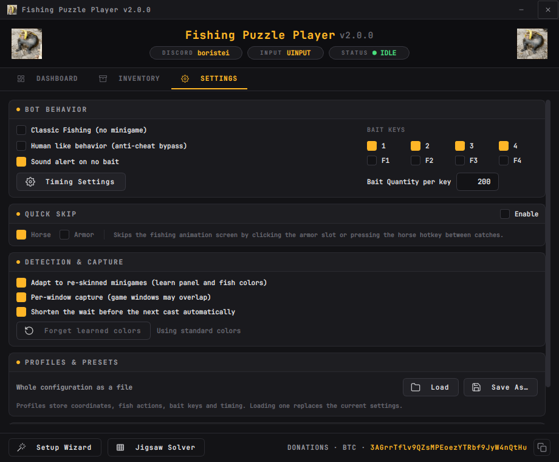

# MT2 Fishing Bot — v2.0.2

Free fishing-minigame bot for Metin2. No subscriptions, no licenses.
**Built for educational and learning purposes only.**

[Video tutorial](https://youtu.be/M0THxnio894) · [Download v2.0.1](https://www.mediafire.com/file/krsxje62vlvt2e0/Fishing_Puzzle_Player_v2.0.1.exe/file) · [Discord server support](https://discord.gg/vZaHCRFqW7)

**Download v2.0.1 (Windows .exe):** [MediaFire](https://www.mediafire.com/file/krsxje62vlvt2e0/Fishing_Puzzle_Player_v2.0.1.exe/file) · [VirusTotal scan](https://www.virustotal.com/gui/url/83eec99981cce231faf64ecd89b88359f5d598da6bb95e0ff1e9b1f6a60e3c58?nocache=1)

More screenshots

## Features

- Up to 8 Metin2 clients at once, new minigame and classic fishing
- Reads the screen only; it never touches game memory
- Auto fish handling per fish type (keep / open / drop), across up to 8 inventory pages
- Built-in jigsaw solver for the fishing puzzle
- Up to 8 bait hotkeys (1–4, F1–F4), quick skip (horse or armor), adjustable timings, human-like clicking
- Adapts to re-skinned minigames, saves and loads profiles
- **F5** pauses and resumes every bot, with a short chime you hear while the game is in front
- Runs on Windows, and on Linux with the game under Wine ([docs/LINUX.md](docs/LINUX.md))

## Quick start

1. Run the bot **as administrator** (Windows) and pick your Metin2 windows. The setup wizard (the highlighted **Fishing setup** / **Jigsaw setup** button at the top right) walks you through the rest, and the **Guide** button (bottom bar, and on each setup card) shows with pictures where to click for every coordinate.
2. In the **Positions** tab, set the position of inventory page 1 and of every further page your client has, in order, so the bot can switch pages when one fills up.
3. Open the inventory and leave it open: the bot reads it to know where catches land and when a page is full, also with automatic fish handling off. Optional: turn on automatic fish handling and choose what to do with each fish.
4. Put bait in the selected hotkey slots and press **START FISHING**.

Quick skip needs a horse (Horse mode), or a spare armor in the inventory with its position set as **Spare Armor** (Armor mode: the bot right-clicks it, which swaps it with the worn armor). Set the page tabs before Spare Armor: the bot then knows the armor's page and switches to it for the right-click while it fills other pages.

## Troubleshooting

| Problem | Fix |
|---|---|
| Bottom of the window cut off by the screen | **Settings → Interface size**: pick a smaller size (or Auto) and restart the bot, or lower the Windows display scale. Below 70 % the window gets shorter and its tabs scroll instead |
| Fish are not opened or dropped | Keep the inventory open, set the drop and confirm positions, then raise the item timings in **Timing Settings** (useful on high ping) |
| Jigsaw pieces not detected | Keep the whole puzzle window visible and uncovered, then **Define Grid** (JIGSAW tab) again so the ghost grid covers the 24 cells exactly. Still failing: send a diagnostic log (below) |
| Jigsaw won't start: "the Confirm point lies on the puzzle grid" | The game opens its confirm dialog in the middle of the screen. Move the puzzle window away from the centre (top left works), then Define Grid and Set Confirm (JIGSAW tab) again — see **Guide → Jigsaw: window placement** |
| Pages stop switching | Re-set the page positions after changing resolution |
| Stops with "Game screen lost" | The inventory vanished while no fish bit (disconnect, death, login screen). Log back in, open the inventory, start again |

The game window can sit in the background but must not be minimized.

### Sending a diagnostic log

If something goes wrong and the table above does not help, send a diagnostic log:

1. **Settings** tab → tick **Diagnostic log** (leave **Verbose** off unless asked for it).
2. Press **START FISHING** (or **START JIGSAW**) and do what triggers the problem, then stop the bot (or let it stop by itself).
3. A file like `diagnostics/20261115_143022.zip` is written **next to the bot's .exe**. The Settings tab shows its path and **Open log folder** opens the folder with it selected.
4. Send that one `.zip` (the newest one) in the [Discord support server](https://discord.gg/vZaHCRFqW7).

It contains what the bot did, what it saw (screenshots of the game window only, never of the rest of the desktop) and the settings it used. If the bot's folder cannot be written to (for example under Program Files), the log goes to a per-user folder instead and the Settings tab shows where. Turn **Diagnostic log** off again afterwards; when it is off, nothing is recorded. Only the last 10 logs are kept.

## Version history

- **2.0.2** — Lighter and faster with several clients, fishing and jigsaw loop fixes, diagnostic log, setup wizards and help pages
- **2.0.1** — Clickable Discord server support button
- **2.0.0** — Linux port (X11/Wine), OS abstraction layer, adaptive detection, profiles
- **1.2.0** — Jigsaw solver, new GUI
- **1.1.x** — Multi-page inventory, timing settings, debug overlays
- **1.0.x** — Classic fishing, fish dropping, fixes

## Development

Test it without the game using the built-in simulator: `python tools/minigame_sim` ([docs/SIMULATOR.md](docs/SIMULATOR.md)). Tests: `python tools/run_tests.py`.

**Planned:** skip the minigame based on chat messages.

## Donations

BTC: `3AGrrTf1v9QZsMPEoezYTRbf9JyW4nQtHu`

*For personal use only. Use at your own risk.*
