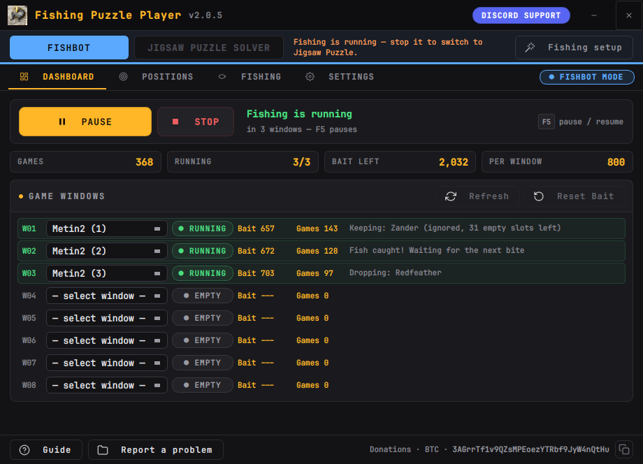
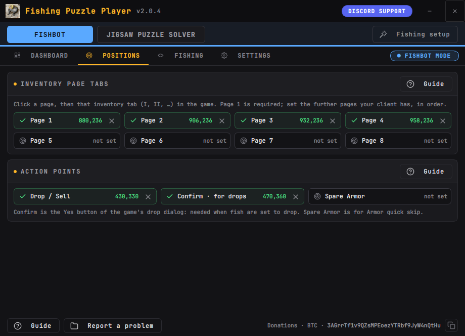

# MT2 Fishing Bot — v2.0.1

Free fishing-minigame bot for Metin2. No subscriptions, no licenses.
**Built for educational and learning purposes only.**

[Video tutorial](https://youtu.be/M0THxnio894) · [Download](releases/windows/) · [Discord server support](https://discord.gg/vZaHCRFqW7)

**Download v2.0.1 (Windows .exe):** [MediaFire](https://www.mediafire.com/file/krsxje62vlvt2e0/Fishing_Puzzle_Player_v2.0.1.exe/file) · [VirusTotal scan](https://www.virustotal.com/gui/url/83eec99981cce231faf64ecd89b88359f5d598da6bb95e0ff1e9b1f6a60e3c58?nocache=1)

More screenshots

## Features

- Up to 8 Metin2 clients at once, new minigame and classic fishing
- Reads the screen only; it never touches game memory
- Auto fish handling per fish type (keep / open / drop), across up to 8 inventory pages
- Built-in jigsaw solver for the fishing puzzle
- Up to 4 bait hotkeys, quick skip (horse or armor), adjustable timings, human-like clicking
- Adapts to re-skinned minigames, saves and loads profiles
- **F5** pauses and resumes every bot
- Runs on Windows, and on Linux with the game under Wine ([docs/LINUX.md](docs/LINUX.md))

## Quick start

1. Run the bot **as administrator** (Windows) and pick your Metin2 windows. The **Setup Wizard** walks you through the rest.
2. In the **Inventory** tab, set the position of inventory pages 1–4 (5–8 are optional) so the bot can switch pages when one fills up.
3. Optional: turn on automatic fish handling and choose what to do with each fish. The inventory must be open.
4. Put bait in the selected hotkey slots and press **Start All**.

Quick skip needs a horse (Horse mode) or an equipped armor with its slot set (Armor mode).

## Troubleshooting

| Problem | Fix |
|---|---|
| Start button not showing | Set Windows display scale to 100% |
| Fish are not opened or dropped | Keep the inventory open, set the drop and confirm positions, then raise the item timings in **Timing Settings** (useful on high ping) |
| Jigsaw pieces not detected | Lower the detection threshold and keep the whole grid visible |
| Pages stop switching | Re-set the Page 1–4 positions after changing resolution |

The game window can sit in the background but must not be minimized.

## Version history

- **2.0.0** — Linux port (X11/Wine), OS abstraction layer, adaptive detection, profiles
- **1.2.0** — Jigsaw solver, new GUI
- **1.1.x** — Multi-page inventory, timing settings, debug overlays
- **1.0.x** — Classic fishing, fish dropping, fixes

## Development

Test it without the game using the built-in simulator: `python tools/minigame_sim` ([docs/SIMULATOR.md](docs/SIMULATOR.md)). Tests: `python tools/run_tests.py`.

**Planned:** skip the minigame based on chat messages.

## Donations

BTC: `3AGrrTf1v9QZsMPEoezYTRbf9JyW4nQtHu`

*For personal use only. Use at your own risk.*
